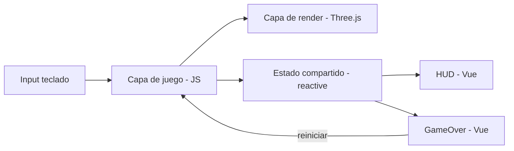
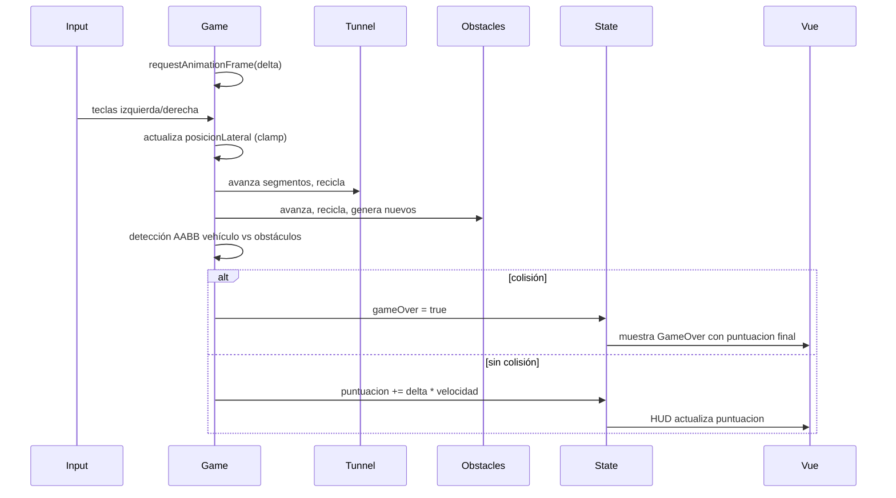

# Documento de Diseño

## Resumen

SPA de una sola pantalla que renderiza un túnel infinito en 3D con Three.js y superpone un HUD y una pantalla de game over gestionados con Vue. El bucle de juego avanza en cada frame, recicla segmentos y obstáculos, detecta colisiones por bounding box y actualiza la puntuación en memoria. No hay backend, ni persistencia, ni enrutado: todo vive en una única página (`index.html`) servida por Vite durante el desarrollo.

## Arquitectura

Tres capas bien separadas dentro del mismo bundle:

1. **Capa de render (Three.js)**: escena, cámara, niebla, luces, túnel procedural, vehículo, obstáculos, partículas. Corre en `requestAnimationFrame`.
2. **Capa de estado y lógica de juego (JS puro)**: mantiene los cuatro campos mínimos (`posicionLateral`, `segmentoActual`, `obstaculoActivo`, `puntuacion`), aplica reglas de movimiento, reciclaje, dificultad progresiva y colisiones.
3. **Capa de UI reactiva (Vue)**: HUD (puntuación) y overlay de game over (puntuación final + botón reiniciar). Se comunica con la capa de juego mediante un objeto reactivo compartido.

## Componentes

| Componente | Responsabilidad | Tecnología |
|---|---|---|
| `Game` (clase/módulo) | Escena, bucle, túnel, vehículo, obstáculos, colisiones | Three.js |
| `TunnelManager` | Generación y reciclaje de segmentos del túnel | Three.js |
| `ObstacleManager` | Generación, reciclaje y bounding boxes de obstáculos | Three.js |
| `Player` | Movimiento lateral y límites del vehículo | Three.js + input |
| `HUD.vue` | Muestra `puntuacion` en tiempo real | Vue |
| `GameOver.vue` | Overlay con puntuación final y botón de reinicio | Vue |
| `useGameState` | Estado reactivo compartido (`posicionLateral`, `puntuacion`, `gameOver`) | Vue (`reactive`) |

## Flujos

### Flujo principal (bucle de juego)

### Flujo de reinicio

`GameOver.vue` emite `restart` → `Game` reinicia `puntuacion`, `posicionLateral`, reposiciona segmentos y obstáculos → `useGameState.gameOver = false` → el HUD vuelve a mostrar la puntuación en vivo.

## Modelo de Datos

Todo el estado vive en memoria (objeto `reactive` de Vue + campos internos del `Game`). No hay persistencia.

| Campo | Tipo | Descripción | Dónde vive |
|---|---|---|---|
| `posicionLateral` | `number` | Desplazamiento lateral del vehículo, acotado a `[-LIMITE, +LIMITE]` | estado reactivo + objeto 3D |
| `segmentoActual` | `number` | Índice o puntero del segmento del túnel que está más cerca de la cámara | `TunnelManager` |
| `obstaculoActivo` | `boolean` | `true` mientras hay al menos un obstáculo cuya bounding box puede colisionar | `ObstacleManager` |
| `puntuacion` | `number` | Distancia acumulada, mostrada como entero | estado reactivo |

## Interfaces e Integraciones

- **Entrada**: eventos `keydown`/`keyup` en `window` para flechas izquierda/derecha (y `A`/`D` como alternativa).
- **GLTFLoader (addon de Three.js)**: carga del modelo low-poly del vehículo y de los obstáculos desde un CDN público. Si la carga falla, se usa un fallback geométrico (`BoxGeometry` con material plano) para no bloquear el juego.
- **Vue (CDN)**: montado sobre `#app`, consumiendo el estado reactivo expuesto por el módulo de juego.
- **Vite**: servidor de desarrollo y build de la SPA.

## Manejo de Errores

- **Fallo al cargar un GLB desde CDN**: `try/catch` en la promesa de `GLTFLoader.load`; se registra en consola y se usa el fallback geométrico. El juego no se interrumpe.
- **Pérdida de foco de la pestaña**: al recibir `visibilitychange` se pausa el bucle y se reanuda al volver, evitando un `delta` gigante que teletransporte el vehículo.
- **Delta anómalo** (por ejemplo, primer frame tras un `tab` inactivo): se recorta a un máximo (`Math.min(delta, 0.05)`).
- **Canvas sin contexto WebGL**: se muestra un mensaje en el HUD y se detiene el bucle, sin `throw` sin capturar.

## Seguridad

MVP puramente local y sin backend, por lo que la superficie es mínima:

- No se almacenan credenciales ni datos de usuario.
- Los assets se cargan desde CDN públicos mediante HTTPS.
- No se usa `eval`, `new Function` ni inyección de HTML (`v-html`) en la UI.
- El único input externo son eventos de teclado, saneados por construcción (se comparan contra una lista cerrada de `key`/`code`).

## Observabilidad

Mínima y suficiente para depurar el MVP:

- Log en consola al cargar cada GLB (éxito o fallback).
- Log en consola al producirse una colisión, con la puntuación final.
- Contador opcional de FPS visible solo en modo desarrollo (se elimina en build de producción mediante `import.meta.env.DEV`).

## Estrategia de Pruebas

- **Pruebas unitarias (Vitest)**: lógica pura del juego — clamp de `posicionLateral`, cálculo de `puntuacion` por delta, reciclaje de segmentos, colisión AABB entre dos `Box3`.
- **Pruebas de integración (Vitest + jsdom)**: montaje del HUD y de `GameOver`, reactividad de `puntuacion`, emisión del evento `restart`.
- **Pruebas manuales**: ejecución en navegador para verificar 60 fps, sensación de velocidad, límites laterales y reinicio sin recarga.
- **Property-based testing (fast-check + Vitest)**: las cuatro propiedades de correctitud definidas en `## Propiedades de Correctitud` se ejecutan con `fast-check` sobre `Vitest`. Los tests viven en `tests/*.property.test.js`.

## Propiedades de Correctitud

Estas propiedades se derivan directamente de los criterios EARS de `requirements.md` y constituyen el contrato que debe verificarse sobre el núcleo del juego. Todas se ejecutan con **fast-check** sobre **Vitest**.

### Property 1 — Clamp de posicionLateral dentro de los límites del túnel

*For any* posición lateral inicial `p0` en `[0, LIMITE]` y cualquier secuencia finita de deltas de tiempo `d ∈ [0, 0.05]` y direcciones `dir ∈ {-1, +1}`, al aplicar el movimiento lateral acumulado, el sistema SHALL mantener `posicionLateral` siempre dentro del intervalo cerrado `[-LIMITE, +LIMITE]`.

**Valida: Requisito 1.2, 1.4**

- Generadores: `fc.float({ min: 0, max: LIMITE, noNaN: true })` para `p0`; `fc.array(fc.tuple(fc.float({ min: 0, max: 0.05, noNaN: true }), fc.constantFrom(-1, 1)))` para la secuencia de pasos.
- Invariante: tras cada paso, `posicionLateral ∈ [-LIMITE, +LIMITE]`; si `p0 ≥ LIMITE - ε` y `dir = +1`, el valor no supera `LIMITE`.
- Exclusiones: `NaN`, `Infinity`, deltas negativos.
- Archivo: `tests/position.property.test.js`

### Property 2 — Monotonía de la puntuación

*For any* puntuación inicial `s0 ≥ 0` y cualquier secuencia finita de deltas de tiempo `d ∈ [0, 0.05]`, tras aplicar el incremento acumulado, el sistema SHALL mantener `puntuacion ≥ s0` y estrictamente creciente si al menos un `d > 0`.

**Valida: Requisito 4.1**

- Generadores: `fc.float({ min: 0, max: 1e6, noNaN: true })` para `s0`; `fc.array(fc.float({ min: 0, max: 0.05, noNaN: true }))` para los deltas.
- Invariante: `puntuacion_final ≥ s0`; si `sum(deltas) > 0`, entonces `puntuacion_final > s0`.
- Exclusiones: deltas negativos o `NaN`.
- Archivo: `tests/scoring.property.test.js`

### Property 3 — Invariante de reciclaje de segmentos del túnel

*For any* número de frames `n ≥ 0` y cualquier secuencia de desplazamientos longitudinales positivos, tras procesar los `n` frames, el sistema SHALL mantener el número de segmentos de túnel vivos en la escena exactamente igual al tamaño del pool (`POOL_SIZE`), sin crear ni destruir instancias.

**Valida: Requisitos 2.1, 2.2, 2.3**

- Generadores: `fc.integer({ min: 0, max: 1000 })` para `n`; `fc.array(fc.float({ min: 0, max: 0.05, noNaN: true }))` para los avances por frame.
- Invariante: `escena.children.filter(esSegmento).length === POOL_SIZE` tras cada frame; la misma referencia de objeto se reutiliza al reciclar (sin `new` en el bucle caliente).
- Exclusiones: avances negativos; `n` no entero.
- Archivo: `tests/recycling.property.test.js`

### Property 4 — Detección de colisión por bounding box

*For any* par de cajas alineadas a los ejes `A` (vehículo) y `B` (obstáculo) con posiciones y dimensiones válidas, el sistema SHALL detectar colisión si y solo si las proyecciones de ambas cajas se solapan en los tres ejes (X, Y, Z), y en ese caso el estado SHALL marcar `gameOver = true`.

**Valida: Requisito 3.4**

- Generadores: `fc.tuple(fc.float(...), fc.float(...), fc.float(...))` para centros; `fc.tuple(fc.float({ min: 0.01, max: 1 }), ...)` para dimensiones (siempre positivas).
- Invariante: `checkCollision(A, B) === (solapeX && solapeY && solapeZ)`; si colisión verdadera, `gameOver === true`.
- Exclusiones: dimensiones ≤ 0; `NaN` en centros o dimensiones.
- Archivo: `tests/collision.property.test.js`

## Decisiones y Alternativas

| Decisión | Alternativa descartada | Motivo |
|---|---|---|
| Vue para HUD/GameOver | Canvas 2D o DOM manual | Reactividad gratuita y menos código para un MVP |
| Reciclaje de segmentos con pool fijo | Crear/destruir segmentos | Evita GC y mantiene 60 fps |
| Colisión por `Box3.intersectsBox` | Esferas o SAT manual | Más simple, suficiente para geometrías cúbicas y cilíndricas |
| Estado en memoria (`reactive`) | Pinia / Vuex / localStorage | El enunciado exige estado efímero; Pinia es sobrediseño |
| Fallback geométrico para GLB | Bloquear hasta que cargue | Evita que un CDN lento rompa la experiencia |
| Movimiento lateral por delta | Velocidad por frame | Independiente del framerate |
| `fast-check` + `Vitest` para PBT | Motor nativo de Kiro IDE | El motor nativo consume créditos por corrida; `fast-check` es replicable fuera del IDE y suficiente como disciplina de pruebas |
| Lógica pura extraída en `src/game/logic.js` | Probar directamente `Game.js` | Permite PBT sin montar Three.js ni canvas, sin mocks pesados |

## Trazabilidad con Requisitos

| Requisito | Componentes implicados | Sección del diseño |
|---|---|---|
| 1. Controlar vehículo | `Player`, input, `posicionLateral` | Componentes, Flujos, Modelo de Datos, Property 1 |
| 2. Generar túnel | `TunnelManager`, `segmentoActual` | Arquitectura, Flujos, Modelo de Datos, Property 3 |
| 3. Esquivar obstáculos | `ObstacleManager`, `obstaculoActivo`, AABB | Componentes, Flujos, Manejo de Errores, Property 4 |
| 4. Ver puntuación y reiniciar | `HUD.vue`, `GameOver.vue`, `puntuacion` | Componentes, Flujos, Estrategia de Pruebas, Property 2 |
